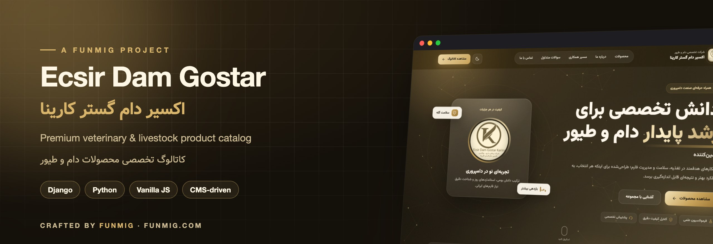
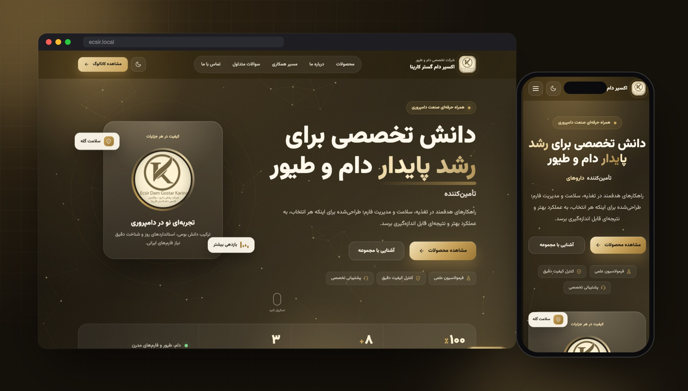
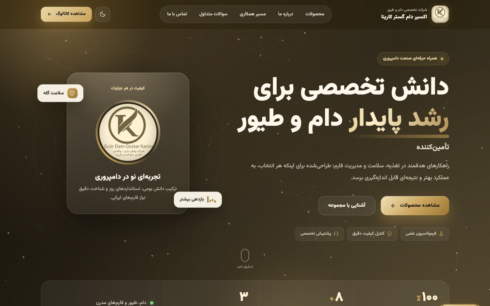
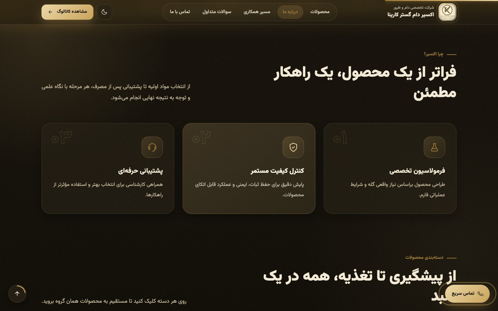
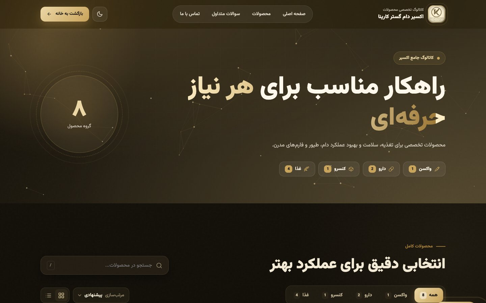
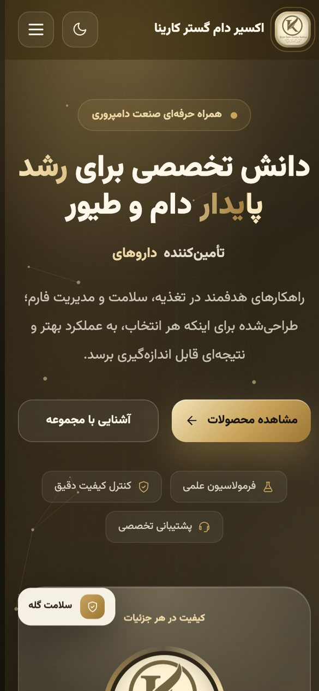

<div align="center">



<br>


<br><br>

**[🇬🇧 English](#-english)** &nbsp;·&nbsp; **[🇮🇷 فارسی](#-فارسی)**

<br>



</div>

<br>

## 🇬🇧 English

**Ecsir Dam Gostar Karina** is a premium corporate website and product catalog for a livestock and poultry health company that supplies vaccines, medicines, canned products and feed. The design is black and gold, with an animated particle network and smooth motion. Every piece of text on the site can be edited from the admin panel.

### ✨ Highlights

<table>
<tr>
<td width="50%" valign="top">

#### 🎨 Experience
- Hero with an animated **particle network** and pointer effects
- Glassmorphism cards, floating badges and count-up stats
- Rotating typewriter words and an infinite logo marquee
- **Dark / light theme** that remembers your choice
- Reveal-on-scroll animations, FAQ accordion, back-to-top button
- Mobile-first layout with a slide-out menu

</td>
<td width="50%" valign="top">

#### ⚙️ Under the hood
- Product catalog with **categories** (vaccine, medicine, canned, feed) and feature lists
- Instant search, sorting and a grid ↔ list toggle
- **CMS-style `SiteContent`**: every label, heading and paragraph is editable in the admin
- `robots.txt` + `sitemap.xml` for SEO
- **Login rate limiting** middleware (8 attempts per 5 minutes)
- HSTS, secure cookies, strict referrer policy and a custom 404 page

</td>
</tr>
</table>

### 📸 Screenshots

| Home | Why us |
|:---:|:---:|
|  |  |

<p align="center">

&nbsp;

</p>

### 🚀 Quick start

```bash
python3 -m venv .venv
source .venv/bin/activate          # Windows: .venv\Scripts\activate
pip install -r requirements.txt
export DJANGO_DEBUG=True           # Windows: $env:DJANGO_DEBUG="True"
python manage.py migrate
python manage.py createsuperuser
python manage.py runserver
```

Open `http://127.0.0.1:8000`, then go to `/admin/` to add products and edit the site copy.

### ⚙️ Configuration

| Variable | Default | Description |
|---|---|---|
| `DJANGO_DEBUG` | `False` | `True` for local development; disables the HTTPS-only settings |
| `DJANGO_SECRET_KEY` | dev key | **Required** in production |

See [`.env.example`](.env.example).

### 🌐 Deployment

<details>
<summary><b>Windows + Waitress</b></summary>

[`start_ecsir.ps1`](start_ecsir.ps1) starts the app with **Waitress** on `127.0.0.1:8002`, in the background, with logs written to `logs/`. If the port is already in use, the script exits without starting a second copy. Put Nginx (or any reverse proxy) in front of it to handle HTTPS.

```powershell
python manage.py collectstatic --noinput
powershell -ExecutionPolicy Bypass -File .\start_ecsir.ps1
```
</details>

### 📂 Structure

```
ecsir_site/   settings, URLs, WSGI, login rate-limit middleware
products/     models (Product, ProductFeature, SiteContent), views, admin,
              site_content defaults, templates, static (css / js / img)
```

<br>

---

<div dir="rtl">

## 🇮🇷 فارسی

**اکسیر دام گستر کارینا** وب‌سایت شرکتی و کاتالوگ محصولات یک مجموعه تخصصی در حوزه سلامت دام و طیور است. این مجموعه واکسن، دارو، کنسرو و خوراک دام عرضه می‌کند. طراحی سایت مشکی و طلایی است و شبکه ذرات متحرک و موشن نرم دارد. **همه متن‌های سایت** از پنل مدیریت قابل ویرایش هستند.

### ✨ امکانات

- بخش هیرو با **شبکه ذرات متحرک** و افکت‌های واکنش به ماوس
- کارت‌های شیشه‌ای، نشان‌های شناور و آمار شمارنده
- کلمات چرخان تایپ‌شونده و نوار لوگوی بی‌پایان
- **تم تیره و روشن** که انتخاب کاربر را به خاطر می‌سپارد
- کاتالوگ محصولات با **دسته‌بندی** (واکسن، دارو، کنسرو، غذا) و جستجوی آنی
- مرتب‌سازی و تغییر نمای شبکه‌ای و لیستی
- سیستم **SiteContent**: هر عنوان، دکمه و پاراگراف از ادمین قابل تغییر است
- `robots.txt` و `sitemap.xml` برای سئو
- **محدودیت تلاش ورود** (۸ تلاش در ۵ دقیقه) و تنظیمات امنیتی HSTS و کوکی امن

### 🚀 اجرا

```bash
python3 -m venv .venv
source .venv/bin/activate
pip install -r requirements.txt
export DJANGO_DEBUG=True
python manage.py migrate
python manage.py createsuperuser
python manage.py runserver
```

سایت در `http://127.0.0.1:8000` و پنل مدیریت در `/admin/` در دسترس است.

### 🌐 استقرار

اسکریپت [`start_ecsir.ps1`](start_ecsir.ps1) برنامه را روی ویندوز با Waitress و روی پورت `8002` اجرا می‌کند. در محیط production متغیر `DJANGO_SECRET_KEY` را تنظیم کنید و `DJANGO_DEBUG` را خاموش نگه دارید.

</div>

<br>

---

<div align="center">

**Crafted with ❤️ by [FUNMIG](https://funmig.com)**

<sub>طراحی و توسعه توسط تیم فان‌میگ</sub>

</div>
